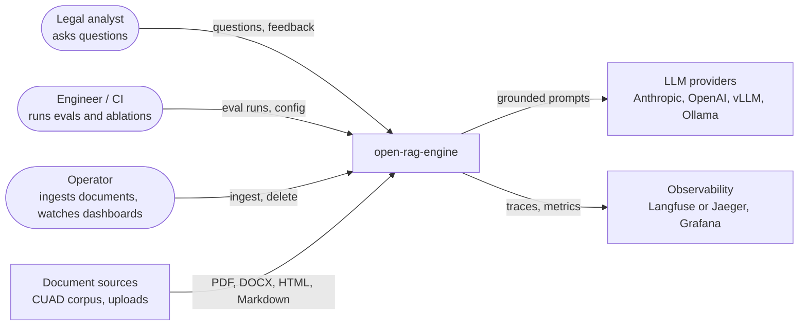

# 01 · Context

The system in its environment: who uses it and which external systems it depends on.

## Actors

| Actor | Goal | Main touchpoint |
| --- | --- | --- |
| Legal analyst | Get a correct answer with sources they can check | Demo UI (P5) or `POST /query` |
| Engineer | Prove a change improves quality without hurting latency or cost | `ore eval`, CI reports |
| Operator | Keep the index current and the system healthy | `ore ingest`, Grafana dashboards |

## External systems

| System | Used for | If unavailable |
| --- | --- | --- |
| LLM providers | Answer generation, query rewriting, LLM judge | Fall back to the secondary provider; if both fail, return the retrieved sources without an answer |
| Document sources | Raw contracts | Ingestion retries, then moves the job to the dead-letter queue |
| Observability backends | Traces, metrics, dashboards | Telemetry is dropped; requests are not affected |

## Scope boundaries

- **In scope:** question answering over a private document collection, with citations, evaluation and operations.
- **Out of scope:** document authoring, contract drafting, user management beyond API keys, OCR of scanned documents.
