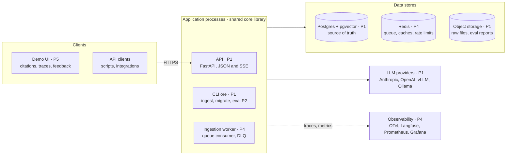

# 02 · Containers

The deployable units: processes and data stores. Postgres is the single source of truth. Documents, chunks, vectors and (from P3) the BM25 full-text index all live there, so updates and deletes are transactional.

All three application processes are built from the same core library, so the diagram connects them as one group. The table below the diagram shows which process uses which store.

## Who uses what

| Process | Postgres | Redis | Object storage | LLM providers |
| --- | --- | --- | --- | --- |
| API | Read chunks, write query log and feedback | Caches, rate limits, enqueue jobs | — | Generation, query rewriting |
| CLI `ore` | Migrations, ingestion writes, eval reads | — | Read source files, write eval reports | Generation and LLM judge during evals |
| Ingestion worker | Ingestion writes | Consume jobs, dead-letter queue | Read source files | — |

## Container responsibilities

| Container | Responsibility | Tech | State | Phase |
| --- | --- | --- | --- | --- |
| API | Query answering, document management, feedback, health and metrics endpoints | Python 3.12, FastAPI, uvicorn | Stateless | P1 |
| CLI `ore` | Ingest, query and migrate from a terminal; `ore eval` runs the eval harness in-process | Typer | Stateless | P1, P2 |
| Ingestion worker | Consumes ingestion jobs with retries and a dead-letter queue | Python, Redis queue | Stateless | P4 |
| Postgres + pgvector | Documents, chunks, vectors, full-text index, query log | Postgres 16, pgvector 0.8 | Source of truth | P1 |
| Redis | Queue, dead-letter queue, caches, rate-limit counters | Redis 7 | Rebuildable | P4 |
| Object storage | Raw source files, eval reports | Local volume, S3 in the cloud | Durable | P1 |
| Observability | Traces, metrics, dashboards | OpenTelemetry collector, Langfuse or Jaeger, Prometheus, Grafana | Telemetry | P4 |

Embedding and reranking models are not containers: they run inside the API, CLI and worker processes. They only become a separate GPU service in the scaled design (see [11 · Deployment](11-deployment.md)).

## Phase 1 simplification

There is no worker or Redis in P1: `ore ingest` calls `IngestionService` in-process. The service is written so the P4 queue worker calls the same function unchanged.
