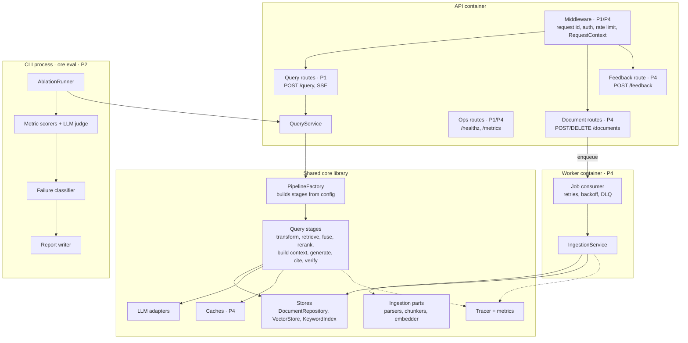

# 03 · Components

What lives inside each application process. The API, worker and CLI share the same core library; they differ only in which entry point and services they run.

## Component catalogue

| Component | Container | Responsibility | Phase |
| --- | --- | --- | --- |
| Middleware | API | Assigns a request id, authenticates the API key, applies rate limits, builds the `RequestContext` (tenant, access tags, debug flag) | P1 (request id), P4 (auth, limits) |
| Query routes | API | Validates input, calls `QueryService`, serialises JSON or SSE | P1 |
| Document routes | API | Uploads and deletes documents by enqueueing ingestion jobs | P4 |
| Feedback route | API | Stores thumbs up/down against a query log row | P4 |
| `QueryService` | API, CLI | Runs the pipeline for one question; owns caching and fallback policy | P1 |
| `PipelineFactory` | Core | Reads config, resolves each stage from the registry, wraps every stage with tracing and timing | P1 |
| Query stages | Core | One class per stage, each implementing `Stage` (see [05](05-interfaces.md)) | P1 to P3 |
| `IngestionService` | CLI, Worker | Hash, diff, parse, chunk, embed and write one document transactionally | P1 |
| Job consumer | Worker | Pulls jobs, retries with backoff, moves poison jobs to the DLQ | P4 |
| `AblationRunner` | CLI | Runs a dataset against a matrix of configs | P2 |
| Metric scorers and judge | CLI | Retrieval, generation, citation, safety and system metrics | P2 |
| Failure classifier | CLI | Assigns each wrong answer to one failure class | P2 |
| Report writer | CLI | Writes versioned JSON and Markdown reports | P2 |

## Why one shared core

`ore eval` calls the same `QueryService` as the API, with a config override. The code being measured is exactly the code being shipped, so an ablation result can't be an artefact of a separate eval-only code path.
