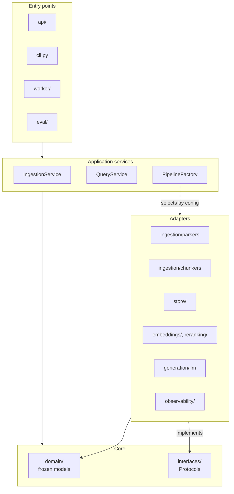

# 04 · Layers

The code follows a ports-and-adapters layout. Arrows show compile-time dependencies: everything points toward the core, and the core imports nothing outside the standard library and Pydantic.



## Layer rules

| Layer | May import | Must not import |
| --- | --- | --- |
| `domain/`, `interfaces/` | Standard library, Pydantic | Anything else in the project, any I/O library |
| Application services | Core, `config/` | Concrete adapters (they receive them by injection) |
| Adapters | Core, their own third-party library | Other adapters, services, entry points |
| Entry points | Everything | — |

These rules are enforced in CI with `import-linter` contracts, so a violation fails the build instead of waiting for review.

## Wiring

Adapters register themselves under a kind and a name. `PipelineFactory` and the entry points resolve them from config, so swapping an implementation never touches calling code.

```python
@register("embedder", "fastembed")
class FastEmbedEmbedder:
    ...

embedder = registry.create("embedder", config.pipeline.embedder)
```

## Package map

| Package | Layer | Responsibility | Phase |
| --- | --- | --- | --- |
| `domain/` | Core | Frozen Pydantic models | P1 |
| `interfaces/` | Core | `Protocol` definitions and the error hierarchy | P1 |
| `config/` | Services | YAML loading, validation, registry, config hashing | P1 |
| `ingestion/` | Services + adapters | `IngestionService`, parsers, chunkers | P1 |
| `embeddings/` | Adapter | Embedder adapters | P1 |
| `store/` | Adapter | Document repository, vector and keyword stores, migrations | P1, P3 |
| `retrieval/` | Adapter | Dense, BM25 and hybrid retrievers, RRF fusion, filter builder | P1, P3 |
| `query/` | Adapter | Query rewriting and multi-query expansion | P3 |
| `reranking/` | Adapter | Cross-encoder and API rerankers | P3 |
| `generation/` | Services + adapters | Prompt builder, LLM adapters, citation mapper and verifier, refusal logic | P1, P2 |
| `pipeline/` | Services | `QueryService`, `PipelineFactory`, stage wrappers | P1 |
| `cache/` | Adapter | Embedding, retrieval and semantic answer caches | P4 |
| `security/` | Adapter | Auth, rate limiting, PII redaction, injection defences, audit log | P4 |
| `observability/` | Adapter | Tracing, metrics | P4 |
| `worker/` | Entry point | Queue consumer | P4 |
| `eval/` | Entry point | Datasets, metrics, judge, ablation runner, reports | P2 |
| `api/` | Entry point | FastAPI app and routes | P1 |
| `cli.py` | Entry point | `ore` commands | P1 |
