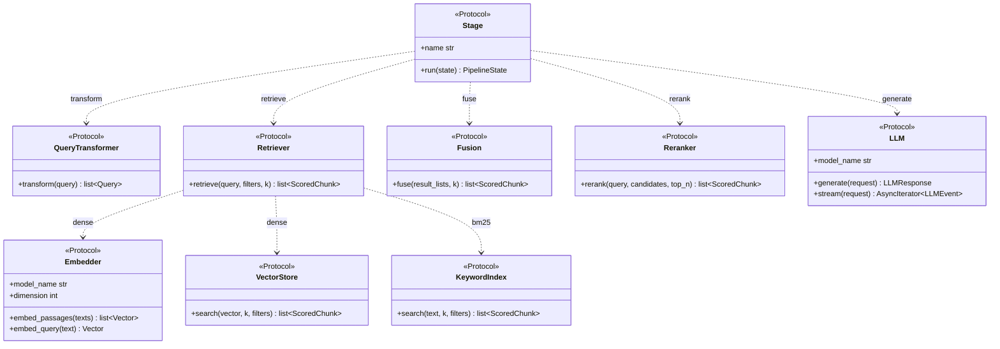
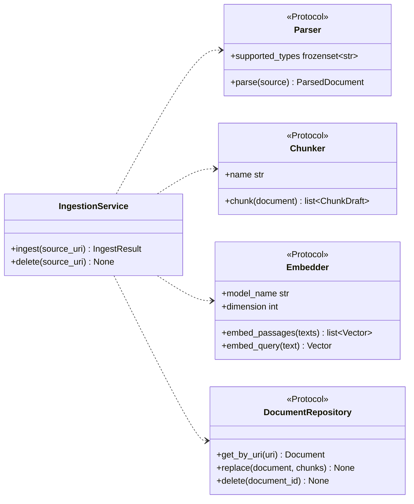
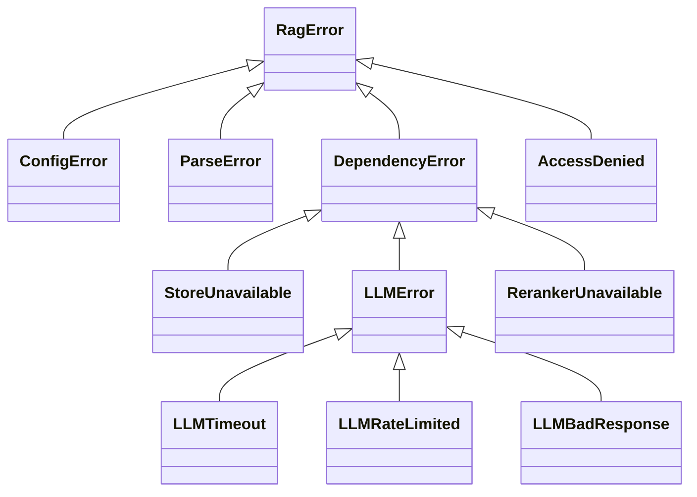

# 05 · Interfaces

Every swappable part is a `typing.Protocol` in `interfaces/`. Implementations don't inherit from them; they only need the right shape, which mypy checks. Tests use small fakes that satisfy the same Protocols, not mocks.

## Query side

`Stage` is the unit `PipelineFactory` composes. Each concrete stage wraps one of the interfaces below it.



Not shown: `Cache[T]` (`get(key)`, `set(key, value, ttl)`), which `QueryService` uses around the whole pipeline rather than inside individual stages.

## Ingestion side



`DocumentRepository.replace` writes the document, its chunks, their vectors and (P3) their full-text column in one transaction.

## Catalogue

| Interface | Implementations | Sync or async | Phase |
| --- | --- | --- | --- |
| `Parser` | `PdfParser` (pypdf), `DocxParser`, `HtmlParser`, `MarkdownParser` | Sync, CPU bound | P1 |
| `Chunker` | `FixedChunker`, `RecursiveChunker`, `StructureChunker`, `SemanticChunker` | Sync, CPU bound | P1, P3 |
| `Embedder` | `FastEmbedEmbedder`, one API embedder | Sync, called in a thread pool | P1, P3 |
| `DocumentRepository` | `PgDocumentRepository` | Async | P1 |
| `VectorStore` | `PgVectorStore`, `QdrantVectorStore` | Async | P1, P4 |
| `KeywordIndex` | `PgFullTextIndex`, `OpenSearchIndex` | Async | P3, P4 |
| `Retriever` | `DenseRetriever`, `Bm25Retriever` | Async | P1, P3 |
| `Fusion` | `ReciprocalRankFusion` | Sync, pure | P3 |
| `Reranker` | `BgeCrossEncoder`, one API reranker | Async | P3 |
| `QueryTransformer` | `LlmRewriter`, `MultiQueryExpander` | Async | P3 |
| `LLM` | `AnthropicLLM`, `OpenAICompatibleLLM` (OpenAI, vLLM, Ollama) | Async | P1 |
| `Stage` | One per pipeline step (see [08](08-query.md)) | Async | P1 |
| `Cache` | `InMemoryCache`, `RedisCache` | Async | P4 |

## Signatures

```python
class Embedder(Protocol):
    model_name: str
    dimension: int
    def embed_passages(self, texts: Sequence[str]) -> list[Vector]: ...
    def embed_query(self, text: str) -> Vector: ...

class VectorStore(Protocol):
    async def search(self, vector: Vector, k: int, filters: SearchFilters) -> list[ScoredChunk]: ...

class Retriever(Protocol):
    name: str
    async def retrieve(self, query: Query, filters: SearchFilters, k: int) -> list[ScoredChunk]: ...

class LLM(Protocol):
    model_name: str
    async def generate(self, request: LLMRequest) -> LLMResponse: ...
    def stream(self, request: LLMRequest) -> AsyncIterator[LLMEvent]: ...

class Stage(Protocol):
    name: str
    async def run(self, state: PipelineState) -> PipelineState: ...
```

## Design rules

- **Filters can't be forgotten.** Retrievers and stores take a `SearchFilters` object, never a raw tenant id. It is built only by `build_filters(ctx: RequestContext, query: Query)`, which always includes the tenant and access tags. A retriever has no way to search without them.
- **Stages don't trace themselves.** `PipelineFactory` wraps every stage with tracing, timing and error mapping, so a new stage gets observability for free and can't skip it.
- **Inputs and outputs are domain objects.** No adapter returns a library type (a pgvector row, an Anthropic message). Each adapter translates at its edge.
- **Adapters declare what they need.** An adapter's config is its own Pydantic model, validated when the registry creates it.

## Errors

Adapters raise typed errors from one hierarchy. Fallback logic in `QueryService` catches specific types, never a bare `Exception`.



| Error | Raised when | Handled by |
| --- | --- | --- |
| `ConfigError` | Invalid config at startup | Process exits with a clear message |
| `ParseError` | A file can't be parsed | Ingestion logs it and continues; the worker sends it to the DLQ |
| `StoreUnavailable` | Vector or keyword store times out | Fallback to the other retriever (see [08](08-query.md)) |
| `LLMTimeout`, `LLMRateLimited` | Provider is slow or throttling | Retry with backoff, then the fallback provider |
| `LLMBadResponse` | Output can't be parsed | One retry, then the answer is returned flagged as uncited |
| `RerankerUnavailable` | Reranker fails or exceeds its budget | Skip reranking, mark the response degraded |
| `AccessDenied` | Missing or invalid API key | 401 or 403 with no detail about what exists |
