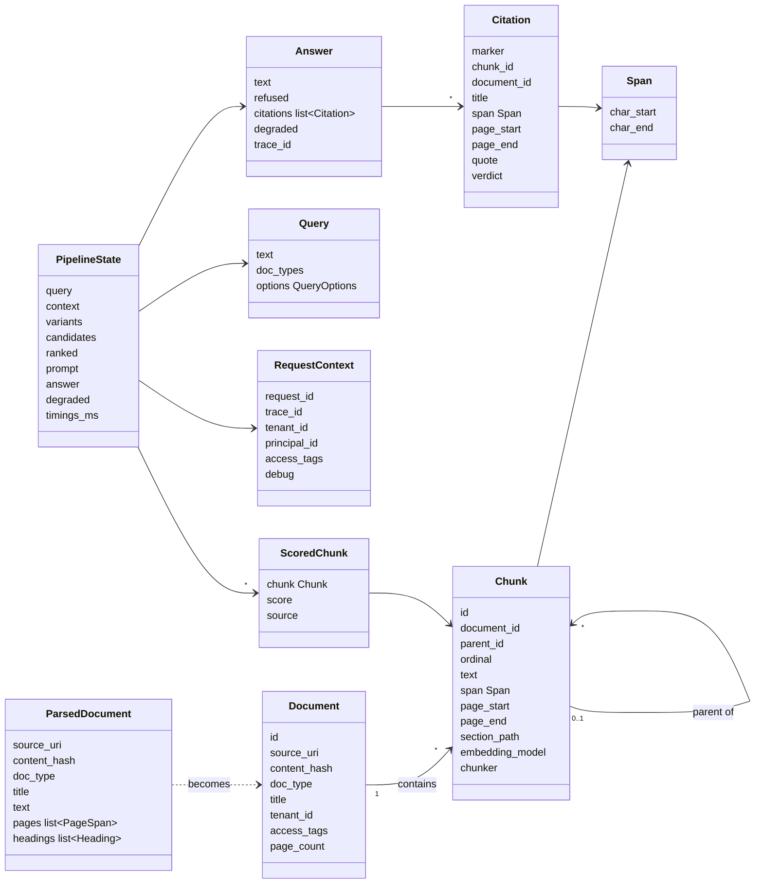

# 06 · Domain model

Domain objects are frozen Pydantic models in `domain/`. They validate their own invariants on construction, so an invalid chunk or citation can't exist anywhere in the system.

## Domain objects

## Invariants

| Object | Invariant |
| --- | --- |
| `Span` | `0 <= char_start < char_end` |
| `Chunk` | `document.text[span.char_start:span.char_end] == chunk.text`; `page_start <= page_end`; text is not empty |
| `ParsedDocument` | Page spans cover the full text with no gaps or overlaps, so any offset maps to exactly one page |
| `ScoredChunk` | `source` is one of `dense`, `bm25`, `fused`, `reranked`; scores are only compared within one source |
| `Citation` | Points to a chunk that was in the prompt; its span lies inside that chunk |
| `Answer` | A refused answer has no citations; a non-refused answer with no citations is flagged `uncited` |
| `RequestContext` | `tenant_id` is always set; it can only be built by the auth middleware or the eval runner |

The chunk span invariant is also a property-based test over every chunker, because off-by-one offsets would make every citation highlight the wrong text.

## Database schema

`tenant_id`, `access_tags` and `doc_type` are copied from documents onto chunks, so filtered ANN search needs no join. pgvector 0.8 iterative index scans keep recall high when filters are selective.

```mermaid
erDiagram
    DOCUMENTS ||--o{ CHUNKS : contains
    CHUNKS |o--o{ CHUNKS : "parent of"
    DOCUMENTS ||--o{ INGESTION_JOBS : "processed by"
    QUERY_LOG ||--o{ FEEDBACK : receives
    QUERY_LOG }o--o{ CHUNKS : cites
    API_KEYS ||--o{ QUERY_LOG : issues

    DOCUMENTS {
        uuid id PK
        text source_uri UK
        text content_hash
        text doc_type
        text title
        text tenant_id
        text_array access_tags
        int page_count
        timestamptz updated_at
    }
    CHUNKS {
        uuid id PK
        uuid document_id FK
        uuid parent_id FK "null for top level"
        int ordinal
        text text
        text_array section_path
        int page_start
        int page_end
        int char_start
        int char_end
        vector embedding "HNSW cosine"
        tsvector search_text "GIN, P3"
        text embedding_model
        text chunker
        text doc_type "copied from document"
        text tenant_id "copied from document"
        text_array access_tags "copied from document"
    }
    INGESTION_JOBS {
        uuid id PK
        uuid document_id FK
        text status "queued, done, failed, dead"
        int attempts
        text last_error
    }
    QUERY_LOG {
        uuid id PK
        text trace_id
        uuid api_key_id FK
        text tenant_id
        text question
        bool refused
        text config_hash
        timestamptz created_at
    }
    FEEDBACK {
        uuid id PK
        uuid query_id FK
        int rating "1 or -1"
        text comment
    }
    API_KEYS {
        uuid id PK
        text key_hash
        text tenant_id
        text_array access_tags
        int rate_limit_per_min
    }
```

| Table | Notes | Phase |
| --- | --- | --- |
| `documents` | One row per source file; `content_hash` drives incremental indexing | P1 |
| `chunks` | Vectors and (P3) full-text column in the same row, so one transaction updates both indexes | P1 |
| `ingestion_jobs` | Job state for the worker and DLQ | P4 |
| `query_log` | Every query with its config hash; doubles as the audit log of who asked what and which chunks were used | P1 (minimal), P4 |
| `feedback` | Thumbs up/down linked to a query, exported as candidate eval cases | P4 |
| `api_keys` | Hashed keys with tenant, access tags and rate limit | P4 |

Indexes: HNSW on `chunks.embedding` (cosine), btree on `chunks(tenant_id, doc_type)`, GIN on `chunks.access_tags` and (P3) `chunks.search_text`, unique on `documents.source_uri`.

Migrations are plain numbered SQL files in `store/migrations/`, applied by `ore migrate`.
