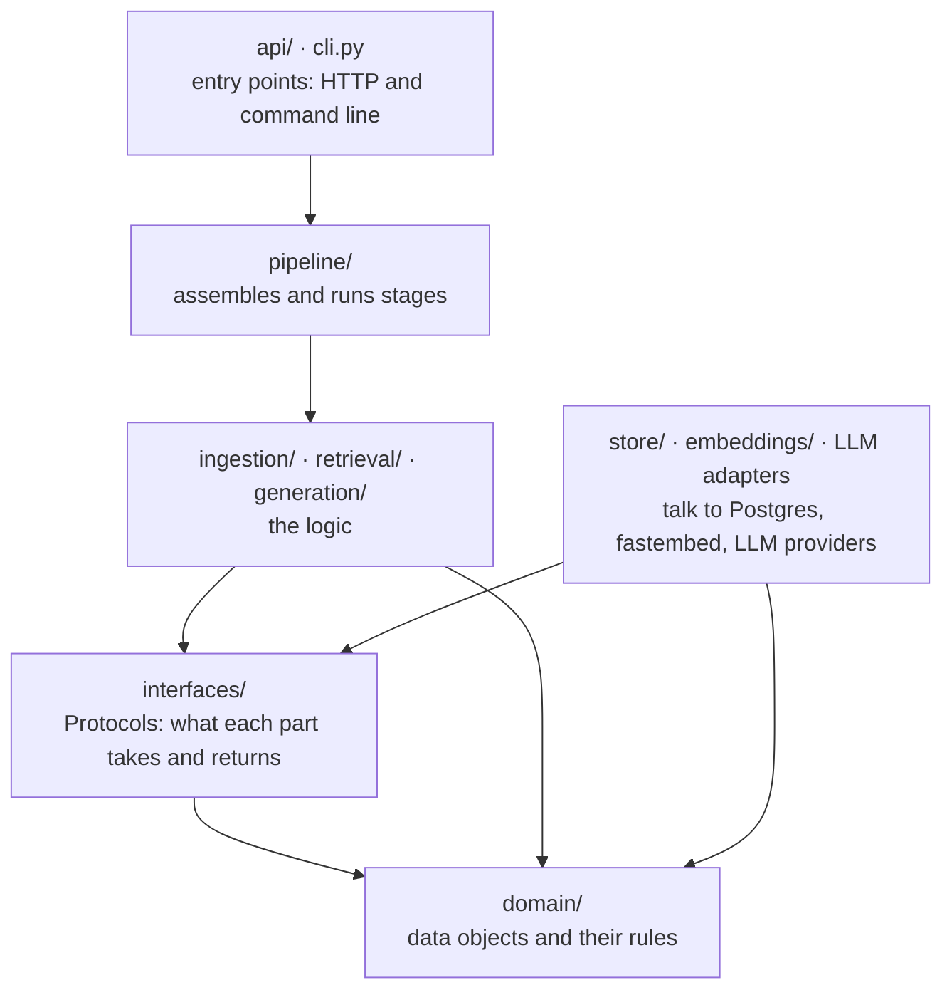
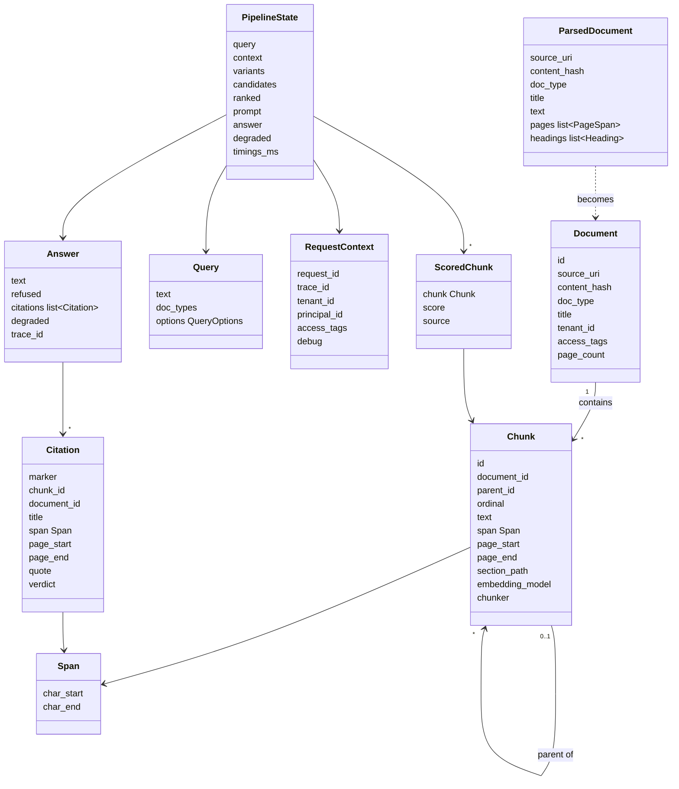
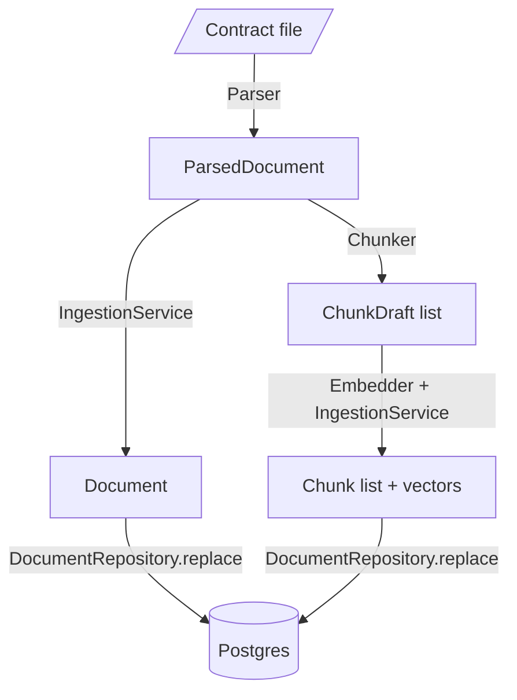
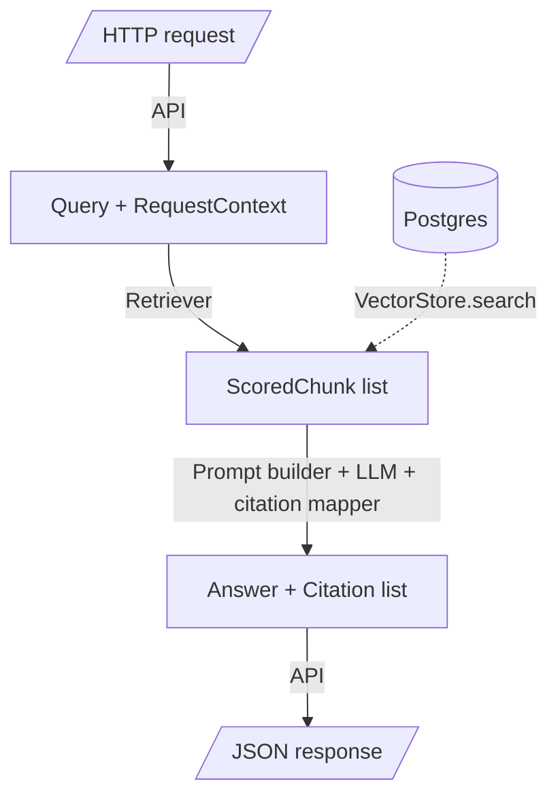
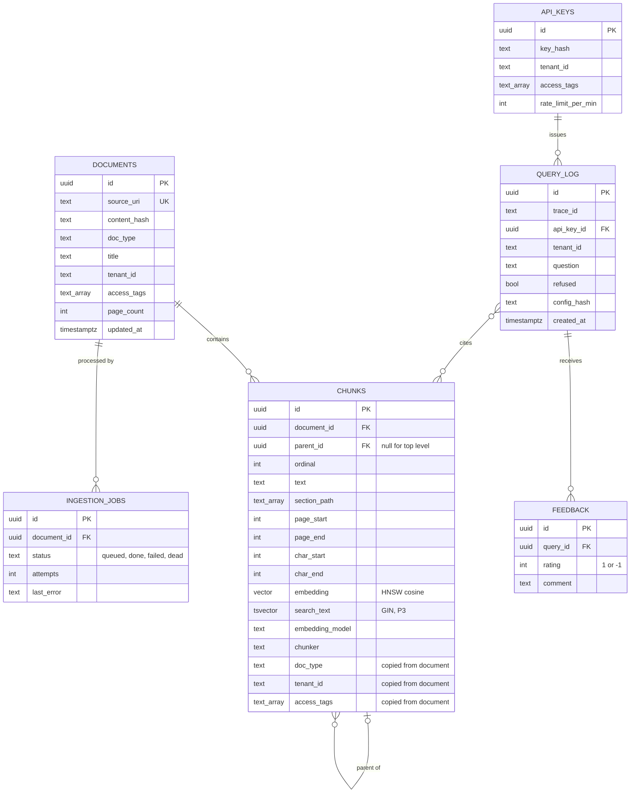

# 06 · Domain model

The domain model is the set of data objects that describe what this system is about: documents, chunks, questions, answers and citations. They live in `domain/` as frozen Pydantic models. Every other part of the code creates, passes around and returns these objects, and none of them depends on Postgres, FastAPI or an LLM SDK.

This page explains why the domain model exists, what each object is for, the rules each object enforces, and how the objects map to the database.

## Why a domain model

"Domain" means the problem area the software deals with. Here it is contracts and cited answers about them. The domain model is the code version of that vocabulary. It is the answer to the question "what does a chunk, a citation or an answer look like?", written down once and shared by everything.

### The problem it solves

A RAG system moves data through many hands: a PDF library, a chunker, an embedding model, a database driver, a web framework and an LLM SDK. Each of them has its own idea of what the data looks like. Without a shared model, the code ends up passing around a mix of:

- plain dicts whose keys nobody remembers (`chunk["start"]` or `chunk["char_start"]`?),
- database rows that drag SQL details into the retrieval logic,
- SDK response objects that tie the citation code to one LLM provider.

Every boundary then needs ad hoc conversions, every function has to defend itself against missing or wrong fields, and a bug in one place shows up far away. In a RAG system the classic example is an off-by-one character offset in the chunker that only becomes visible as a citation highlighting the wrong sentence.

### What it gives us

| Benefit | What it means here | Example |
| --- | --- | --- |
| **One vocabulary** | Every module speaks in the same objects. A `Chunk` means the same thing in the chunker, the store, the retriever and the API. | The citation mapper takes `ScoredChunk`s and returns `Citation`s; it never sees a database row or an LLM SDK type. |
| **Invalid data can't exist** | Each object checks its rules when it is built. If it was built, it is valid, so downstream code doesn't re-check. | `Span(char_start=40, char_end=10)` fails at once, inside the chunker that made the mistake, instead of later as a wrong highlight. |
| **Immutability** | Objects can't change after they are built. Pipeline stages return new objects instead of editing old ones. | The debug response can show the candidates before and after reranking, because the "before" list was never overwritten. |
| **Independence from infrastructure** | The domain imports nothing from the project's adapters. Swapping pgvector for Qdrant, or Anthropic for a local model, changes an adapter, not the domain. | Phase 3 adds BM25 and a reranker. They return the same `ScoredChunk`, so nothing else changes. |
| **Cheap, honest tests** | Objects are plain values, so tests build them directly and use small fakes instead of a database or an LLM. | A citation test builds three `ScoredChunk`s and a fake LLM answer in five lines, with no Postgres. |
| **Reproducible evaluation** | Phase 2 compares pipeline variants. Frozen inputs and outputs mean a run can be recorded and replayed exactly. | An eval run stores each `PipelineState`, so a regression can be traced to the stage that caused it. |

## Where it sits

The domain is the centre of the dependency graph. Every arrow points inward, towards it.



`domain/` imports only the standard library and Pydantic. It must never import from any other package in the project, and it must never import a database driver, a web framework or an LLM SDK. Task 2 of Phase 1 enforces this with a ruff `banned-api` rule that fails the build if `domain/` imports one of those libraries.

## The objects

Each object answers one question. The table lists them in the order data meets them.

| Object | What it represents | Created by | Used by | Phase |
| --- | --- | --- | --- | --- |
| `ParsedDocument` | A file's full extracted text, plus a page table (which character range is on which page) and the heading positions | `Parser` | `Chunker`, `IngestionService` | P1 |
| `Document` | The stored record of one source file: identity, content hash, type, tenant and access tags. It has no text; that lives in the chunks. | `IngestionService` | `DocumentRepository`, citations (title) | P1 |
| `ChunkDraft` | A chunk before it has an id or an embedding: text, span, pages and section path | `Chunker` | `IngestionService` | P1 |
| `Chunk` | One searchable piece of a document, with its exact position in the source (`Span` and pages) and which chunker and embedding model produced it | `IngestionService` (from a draft) | Store, retriever, citations | P1 |
| `Span` | A character range `[char_start, char_end)` inside a document's full text | Parser, chunker | `Chunk`, `Citation` | P1 |
| `Query` | What the user asked, plus their filters (document types) and options (top-k, debug) | API, CLI, eval runner | Every query stage | P1 |
| `RequestContext` | Who is asking and under which tenant and access tags, plus the request and trace ids | Auth middleware (P4), eval runner; a default context in P1 | Filter building, logging, tracing | P1, P4 |
| `ScoredChunk` | A chunk with a score and the name of the method that scored it (`dense`, `bm25`, `fused`, `reranked`) | Retriever, fusion, reranker | Next stage, prompt builder, debug output | P1, P3 |
| `PipelineState` | Everything known about one request so far: the query, context, candidates, ranking, prompt, answer, timings and degraded flags | `QueryService` | Each `Stage` returns an updated copy | P1 |
| `Answer` | The final answer text, whether the system refused, its citations and the trace id | Answer generator | API, eval runner | P1 |
| `Citation` | One `[n]` marker in the answer, resolved to a chunk, document, page range, span and quote; in P2 also a verifier verdict | Citation mapper | API response, citation verifier (P2) | P1, P2 |

Small boundary types such as `SearchFilters`, `LLMRequest` and `LLMResponse` belong to `interfaces/`, because they describe how to call a component rather than what the system is about.

### Object map



`ChunkDraft` is not drawn: it has the same position fields as `Chunk`, without `id`, `document_id` and `embedding_model`.

## How the objects flow

The two pipelines are chains of transformations from one domain object to the next. Boxes are domain objects; arrow labels are the components that do each step.

**Ingestion** (`ore ingest`): a file becomes a stored document and its chunks.



**Query** (`POST /query`): a question becomes a cited answer.



Inside the query pipeline, the objects travel together in a `PipelineState`. Each stage receives the current state and returns a new one with its own part filled in:

| After stage | New in the state |
| --- | --- |
| Start | `query`, `context` |
| Retrieve | `candidates` (`ScoredChunk`s from the retriever) |
| Rerank (P3) | `ranked` (same chunks, new scores and order) |
| Build prompt | `prompt` (numbered context blocks) |
| Generate and cite | `answer` (text, refusal flag, `Citation`s) |
| Every stage | an entry in `timings_ms`; a `degraded` entry if a fallback was used |

Because no stage overwrites an earlier field, the debug flag can return the state after every stage at no extra cost.

## Invariants

An invariant is a rule that must always be true for an object. Some rules can be checked by the object alone, when it is built. Others involve two objects, for example a chunk and the document it came from, so the code that builds them checks those rules.

| Object | Invariant | Checked where | What breaks without it |
| --- | --- | --- | --- |
| `Span` | `0 <= char_start < char_end` | Constructor | Empty or reversed highlights; slicing returns the wrong text |
| `Chunk` | Text is not empty; `page_start <= page_end`; `span` length equals text length | Constructor | Empty chunks pollute retrieval; impossible page ranges in citations |
| `Chunk` | `document.text[span.char_start:span.char_end] == chunk.text` | Every chunker, by a property-based test over random documents | Every citation highlights text that is shifted by a few characters |
| `ParsedDocument` | Page spans cover the full text with no gaps or overlaps, so any offset maps to exactly one page | Constructor | A citation can't say which page it is on, or names two pages |
| `ScoredChunk` | `source` is one of `dense`, `bm25`, `fused`, `reranked` | Constructor (a `Literal` type) | Scores from different methods get compared as if they meant the same thing |
| `Citation` | Its span lies inside its chunk's span | Citation mapper, which has the chunk at hand | The quote shown to the user isn't in the cited chunk |
| `Citation` | Points to a chunk that was in the prompt | Citation mapper, which drops markers that don't match a context block | The model "cites" a source it never saw |
| `Answer` | A refused answer has no citations; an answer that isn't refused and has no citations is flagged `uncited` | Constructor | Unsupported answers look as trustworthy as supported ones |
| `RequestContext` | `tenant_id` is always set | Constructor (required field, no default) | A query searches across all tenants' documents |

The chunk span rule is the most important one in the project. Phase 1's exit gate is a citation pointing to the correct document, page and span, and that is only possible if this rule holds for every chunker.

## Immutability in practice

All domain objects are frozen: assigning to a field after construction raises an error. Three rules keep that guarantee real:

1. **Collections are tuples, not lists.** A frozen model holding a list can still have that list edited in place. Fields use `tuple[...]` so frozen goes all the way down. Functions may still return `list[...]`; models store tuples.
2. **Changes go through `evolve()`.** Pydantic's `model_copy(update=...)` skips validation, so a stage could build an invalid state by accident. A small `evolve(obj, **changes)` helper in `domain/` makes the copy and re-runs validation.
3. **No hidden state.** Objects hold no database connections, caches or lazy loaders. What you see in the fields is everything there is.

The payoff is threefold. Debug snapshots are free, because old states are never overwritten. Stages can run concurrently without locks, because nothing shared can change. Eval runs are reproducible, because a recorded state can't drift after it is saved.

## What belongs in the domain

| Belongs in `domain/` | Does not belong |
| --- | --- |
| Fields and their types | Database queries, HTTP calls, file reads |
| Validation of the object's own invariants | Rules that need another component, such as "this chunk exists in the store" |
| Pure helpers derived from the fields, such as `Span.length` or `ParsedDocument.page_for_offset(offset)` | Business processes such as chunking, ranking or prompt building, which live in the logic packages |
| `evolve()` and other small value helpers | Library types such as pgvector rows, Anthropic messages or FastAPI requests |

A useful test: if a function needs anything other than the object's own fields to do its job, it doesn't belong in the domain.

## Domain, database and API are separate shapes

The same information appears in three places, each shaped for its own job:

| Shape | Lives in | Shaped for | Example difference |
| --- | --- | --- | --- |
| Domain object | `domain/` | Correctness inside the program | `Chunk.span` is a `Span` object with its own checks |
| Database row | `store/migrations/*.sql` | Storage, indexes and filtered search | `chunks` has flat `char_start` and `char_end` columns, plus copies of `tenant_id`, `doc_type` and `access_tags` so filtered search needs no join |
| API schema | `api/` | A stable public contract | The response flattens a `Citation` into JSON and can add fields without changing the domain |

Adapters translate at the edge: `PgVectorStore` turns rows into `ScoredChunk`s, and the API turns an `Answer` into its response schema. This lets the schema change for performance, or the API change for clients, without touching the rest of the code.

## Example

A shortened version of what Task 2 implements:

```python
from pydantic import BaseModel, ConfigDict, model_validator


class Span(BaseModel):
    model_config = ConfigDict(frozen=True)

    char_start: int
    char_end: int

    @model_validator(mode="after")
    def _check_order(self) -> "Span":
        if not 0 <= self.char_start < self.char_end:
            raise ValueError(f"invalid span [{self.char_start}, {self.char_end})")
        return self

    @property
    def length(self) -> int:
        return self.char_end - self.char_start
```

```python
Span(char_start=40, char_end=10)        # ValidationError: invalid span [40, 10)

span = Span(char_start=10, char_end=40)
span.char_end = 50                      # ValidationError: instance is frozen

state = evolve(state, candidates=hits)  # new, validated state; the old one is unchanged
```

## Database schema

`tenant_id`, `access_tags` and `doc_type` are copied from documents onto chunks, so filtered ANN search needs no join. pgvector 0.8 iterative index scans keep recall high when filters are selective.



| Table | Notes | Phase |
| --- | --- | --- |
| `documents` | One row per source file; `content_hash` drives incremental indexing | P1 |
| `chunks` | Vectors and (P3) full-text column in the same row, so one transaction updates both indexes | P1 |
| `ingestion_jobs` | Job state for the worker and DLQ | P4 |
| `query_log` | Every query with its config hash; doubles as the audit log of who asked what and which chunks were used | P1 (minimal), P4 |
| `feedback` | Thumbs up/down linked to a query, exported as candidate eval cases | P4 |
| `api_keys` | Hashed keys with tenant, access tags and rate limit | P4 |

Indexes: HNSW on `chunks.embedding` (cosine), btree on `chunks(tenant_id, doc_type)`, GIN on `chunks.access_tags` and (P3) `chunks.search_text`, unique on `documents.source_uri`.

Migrations are plain numbered SQL files in `store/migrations/`, applied by `ore migrate`.
