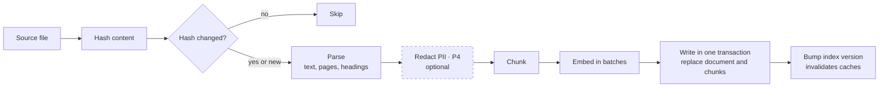
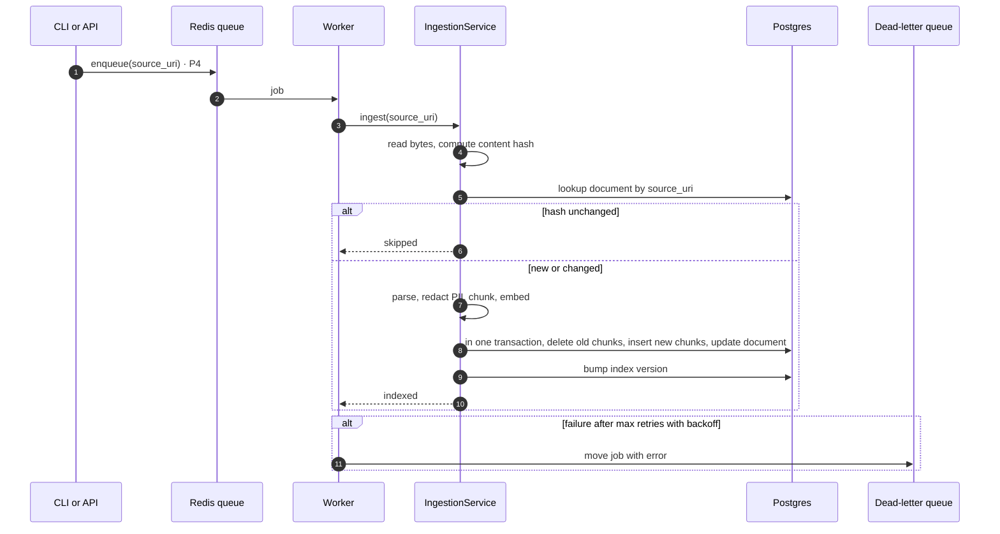
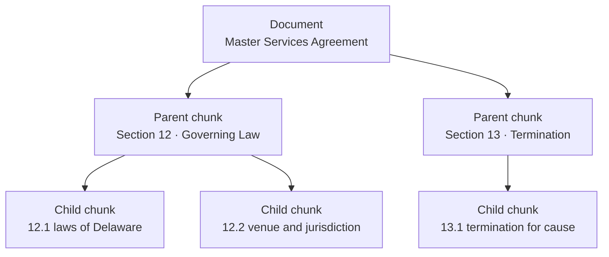

# 07 · Ingestion

How a source file becomes searchable chunks. `IngestionService.ingest(source_uri)` is the single entry point; the CLI calls it directly in P1, and the queue worker calls it in P4.

## Flow



## Sequence



## Consistency rules

| Event | What happens | Guarantee |
| --- | --- | --- |
| New file | Parsed, chunked, embedded, inserted | Document and chunks appear together or not at all |
| Unchanged file | Skipped after the hash check | Re-running ingest on the same corpus does no work |
| Changed file | Old chunks deleted, new chunks inserted, in one transaction | Queries never see a mix of old and new chunks |
| Deleted file (`--prune` or `DELETE /documents`) | Document row deleted, chunks cascade | No stale chunks in any index, because BM25 lives in the same table |
| Embedding model changed | Writes are refused until a full reindex | No index mixes vectors from two models |
| Parse failure | Logged with the file and reason; the run continues | One bad file never blocks the rest; the worker retries, then uses the DLQ |

In the scaled design, where vectors live in Qdrant and BM25 in OpenSearch, a single transaction is no longer possible. There, Postgres keeps an outbox table of index changes and a relay applies them to both indexes idempotently. See [11 · Deployment](11-deployment.md).

## Chunking

| Strategy | Splits on | Phase |
| --- | --- | --- |
| Fixed | Token windows with overlap | P1 |
| Recursive | Headings, then paragraphs, then sentences, until under the size limit | P1 |
| Structure-aware | Contract sections and clause numbers (`12.1`, `ARTICLE IV`) | P3 |
| Semantic | Embedding-similarity breakpoints between sentences | P3 |

Token counts use the embedder's own tokenizer, so a chunk never gets silently truncated at embedding time. The chunking study in P3 compares all four on the eval set.

### Parent/child chunks (P3)

Retrieval runs on small child chunks for precision. The context builder then swaps each hit for its parent, so the LLM sees the whole clause or section.



## Configuration

```yaml
ingestion:
  parsers: [pdf, docx, html, markdown]
  pii_redaction: false            # P4
chunker: {name: recursive, size_tokens: 400, overlap_tokens: 50}
embedder: {name: fastembed, model: BAAI/bge-small-en-v1.5, batch_size: 64}
```
