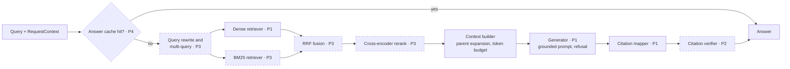
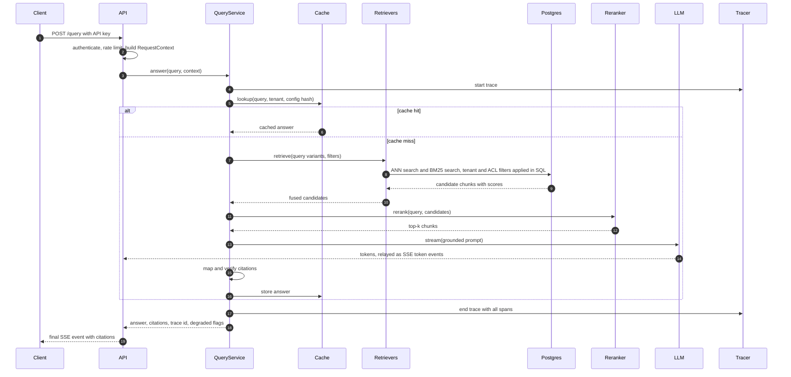
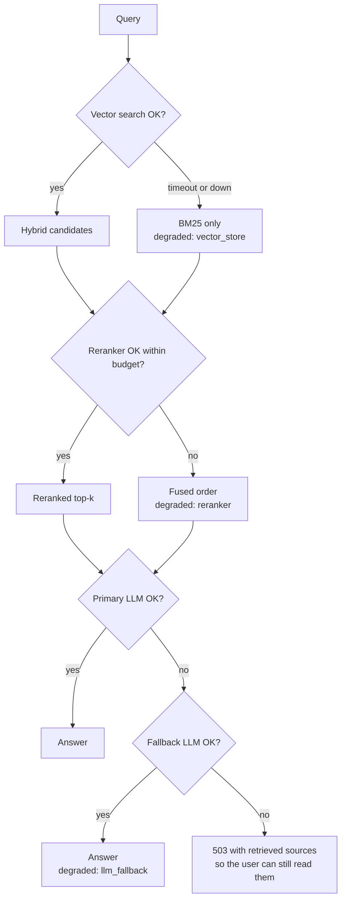

# 08 · Query

How a question becomes a cited answer. `QueryService` runs a sequence of stages that `PipelineFactory` assembles from config. Dashed stages are optional and can be switched off per request or per eval run.

## Pipeline



| Stage | Reads from state | Adds to state | Phase |
| --- | --- | --- | --- |
| Transform | `query` | `variants` (rewritten and expanded queries) | P3 |
| Retrieve | `variants`, `context` | `candidates` per retriever | P1 |
| Fuse | `candidates` | one fused list | P3 |
| Rerank | fused list | `ranked` top-n | P3 |
| Build context | `ranked` | parent-expanded chunks within the token budget | P1 |
| Generate | context chunks | `prompt`, raw answer | P1 |
| Cite | raw answer, context chunks | `answer` with `citations` | P1 |
| Verify | `answer` | a verdict on each citation | P2 |

Each stage takes the state and returns a new one. Because the state is immutable, the debug response can return a snapshot after every stage: candidates and scores before and after reranking, the final prompt and the timings.

## Sequence



## Grounding and citations

- The prompt numbers each context chunk (`[1]`, `[2]`, …) inside clear delimiters and says the content is data, not instructions.
- The model must cite with `[n]` markers or answer that the evidence is missing.
- The citation mapper keeps only markers that point to a chunk in the prompt and resolves each to document, pages and character span.
- The answer is refused, without calling the LLM, when no candidate scores above `refusal_min_score`.
- An answer that is not refused but has no valid citation is returned flagged `uncited`, never hidden.

## API contract

```json
{
  "answer": "The agreement is governed by the laws of Delaware [1].",
  "refused": false,
  "uncited": false,
  "degraded": [],
  "trace_id": "4bf92f3577b34da6",
  "citations": [
    {"marker": 1, "chunk_id": "…", "document_id": "…", "title": "…",
     "page_start": 12, "page_end": 12, "char_start": 40211, "char_end": 40388,
     "quote": "…", "verdict": "supported"}
  ],
  "debug": {"stages": [{"name": "retrieve", "candidates": [{"chunk_id": "…", "score": 0.83}], "ms": 14}], "prompt": "…"}
}
```

SSE streams send `token` events while the answer is generated, then one `citations` event and one `done` event. Citations come last because they can only be resolved once the full answer is known. `debug` is present only when the request sets `debug: true` and the key is allowed to use it.

## Caching (P4)

| Tier | Key | Stores | Invalidated by |
| --- | --- | --- | --- |
| Query embedding | model + normalized query | Vector | Embedding model change |
| Retrieval results | normalized query + filters + config hash + index version | Ranked chunk ids | Index version bump on ingest |
| Semantic answer | query embedding similarity above a threshold, within one tenant and access-tag set | Answer + citations | Index version bump, TTL |

Every cache key includes the tenant and access tags, so a cache can never return an answer across permissions.

## Reliability and fallbacks (P4)

Each dependency has a timeout, retries with exponential backoff and a fallback. When a fallback is used, the response lists it in `degraded` and the span records it.



## Configuration

One YAML file describes a full pipeline. Its hash is stored on every query log row and every eval report, so any number can be reproduced.

```yaml
pipeline:
  query_transform: null          # P3: {name: multi_query, n: 3}
  retrievers: [dense]            # P3: [dense, bm25]
  fusion: null                   # P3: {name: rrf, k: 60}
  reranker: null                 # P3: {name: bge-reranker, top_n: 8}
  context: {max_tokens: 6000, expand_parents: false}
  generator: {provider: anthropic, refusal_min_score: 0.35, timeout_s: 30}
  fallback_generator: null       # P4
store: {name: pgvector, hnsw: {m: 16, ef_construction: 64, ef_search: 40}}
```
