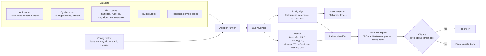
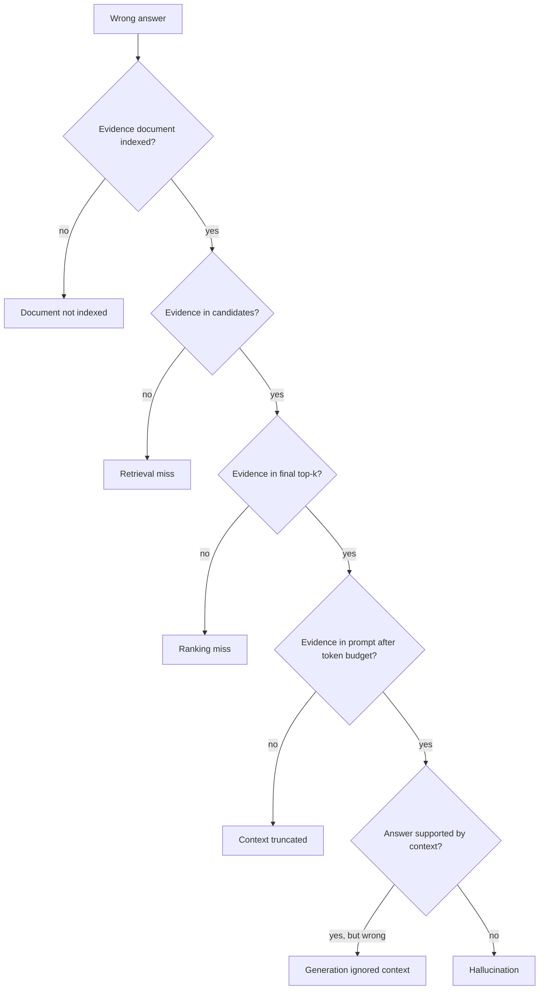

# 09 · Evaluation

How quality is measured, gated in CI and diagnosed. The eval runner calls the same `QueryService` as the API, with a config override, so the code being measured is the code being shipped.

## Flow

## Datasets

| Dataset | Size | Source | Purpose |
| --- | --- | --- | --- |
| Golden set | 200+ | Hand-written and hand-checked on CUAD | Primary quality signal |
| Synthetic set | 500+ | Generated from chunks, LLM-filtered, spot-checked | Broader coverage |
| Hard cases | 50+ | Hand-written | Multi-hop, numeric, negation, unanswerable, near-duplicate clauses |
| BEIR subset | Standard | Public benchmark | Comparability with published retrieval numbers |
| Feedback cases | Growing | Thumbs-down answers, triaged by hand | Turn production failures into regression tests |

Each case is a question, a reference answer and the evidence spans (document and character range) that support it. Evidence spans make retrieval metrics exact instead of judged.

## Metrics

| Layer | Metrics | How |
| --- | --- | --- |
| Retrieval | Recall@k, MRR, nDCG@10 | Overlap of retrieved spans with evidence spans |
| Generation | Faithfulness, answer relevance, correctness | LLM judge with a fixed rubric |
| Citations | Precision and recall | Citation verifier against evidence spans |
| Safety | Correct refusal rate | Unanswerable cases |
| System | p50/p95 latency, time to first token, cost per query | Span timings and token counts |

The judge is calibrated against about 50 human labels, and the agreement rate is published with every report. A judge prompt or model change requires re-calibration.

## Failure taxonomy

Every wrong answer gets exactly one class. The classifier checks them in this order, using the debug snapshots from the pipeline:

Each class points to a different fix: ingestion, retrieval, reranking, context building or the prompt. The report shows counts per class so effort goes where failures actually are.

## Reports and CI

- `ore eval --dataset golden --config configs/default.yaml` writes `reports/<date>-<git sha>-<config hash>/report.{json,md}`.
- `ore eval --ablate hybrid,reranker,rewrite` runs the config matrix and writes one comparison table.
- **Pull requests** run a fast subset (about 50 cases). A drop beyond the threshold on any headline metric fails the build.
- **Nightly** runs the full suite and appends to a trend file, so slow regressions across many commits show up too.
