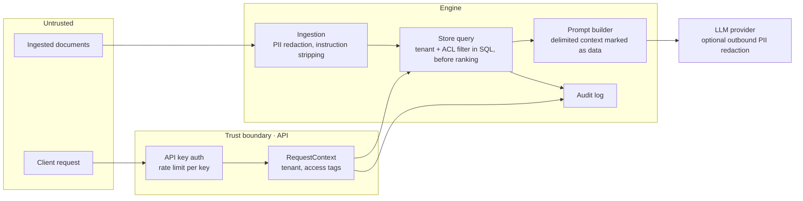

# 10 · Security

Security is enforced at retrieval time, not hoped for at generation time. Retrieved text is treated as untrusted data.

## Trust boundaries

## Controls

| Threat | Control | Where | Phase |
| --- | --- | --- | --- |
| Unauthenticated access | API keys, stored hashed, checked in middleware | `security/`, API | P4 |
| Abuse and cost blow-up | Rate limit per key, token budget per request | Middleware, Redis | P4 |
| Cross-tenant leakage | `tenant_id` filter in every store query, built only from `RequestContext` | `retrieval/filters.py` | P1 (column), P4 (enforced) |
| Reading restricted documents | Access tags on chunks, matched against the key's tags before ranking | Store query | P4 |
| Leakage through caches | Tenant and access tags in every cache key | `cache/` | P4 |
| Prompt injection in documents | Delimited context, "data not instructions" framing, instruction stripping at ingestion, an injection test suite | `generation/`, `ingestion/` | P1 (framing), P4 (suite) |
| PII sent to providers | Optional Presidio redaction at ingestion and before prompts leave the system | `security/pii.py` | P4 |
| Secrets in code | Keys only from environment or a vault; startup fails if a required secret is missing | `config/` | P1 |
| Unexplained data access | Audit log of who asked what and which chunks were used | `query_log` | P4 |
| Information leakage in errors | Error envelope with a code and request id, never a stack trace or a hint about what exists | API | P1 |

## Test suites

- **Tenant isolation:** seeds two tenants with near-identical documents and asserts tenant A never retrieves, is cited, or gets a cached answer from tenant B, across every retriever and cache tier.
- **Access tags:** a key without a tag never sees chunks carrying it, including through parent expansion.
- **Prompt injection:** a corpus of hostile documents ("ignore previous instructions", fake system prompts, instructions to cite other documents). The suite checks the answer doesn't follow them and the citations stay valid.
- **Auth and limits:** missing, invalid, revoked and rate-limited keys get the right status codes.
