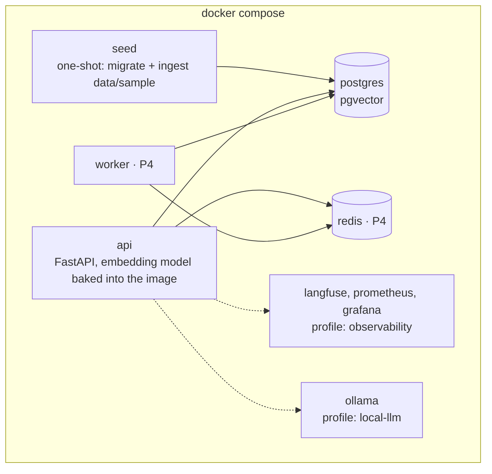
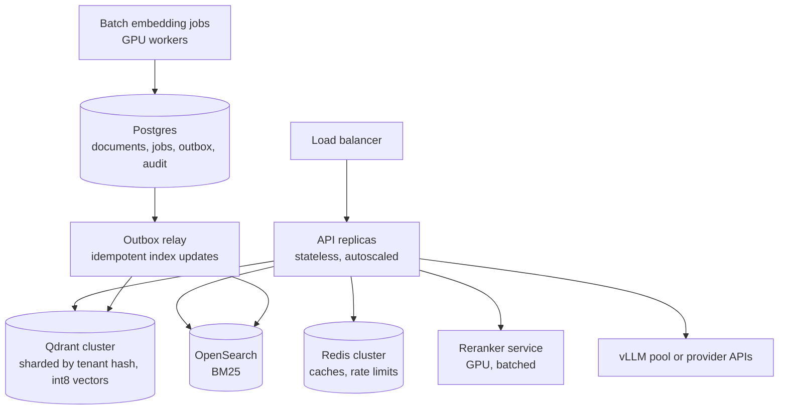

# 11 · Deployment

Two shapes of the same architecture: a local `docker compose` stack for development and the demo, and a documented design for 10M documents.

## Local (P1 to P4)

| Service | Starts by default | Notes |
| --- | --- | --- |
| `postgres` | Yes | Data on a named volume |
| `seed` | Yes | Runs migrations and ingests the sample corpus, then exits; skips unchanged files on later starts |
| `api` | Yes | Waits for `seed` to finish |
| `redis`, `worker` | From P4 | |
| Observability stack | No | `docker compose --profile observability up` |
| `ollama` | No | `docker compose --profile local-llm up`, for running without an API key |

Target: from a clean clone, `docker compose up` answers a query in under five minutes on a laptop.

## Scaled design (10M documents)

Documented in P4 and benchmarked at 100K and 1M chunks. The 10M numbers are a design estimate built on those benchmarks.

What changes compared with local:

| Concern | Local | Scaled |
| --- | --- | --- |
| Vector index | pgvector HNSW in Postgres | Qdrant, sharded by tenant hash, int8 quantization with float rescoring |
| Keyword index | Postgres full-text in the same row | OpenSearch |
| Consistency | One transaction | Postgres outbox plus an idempotent relay to both indexes |
| Embedding | In-process, CPU | Batch GPU jobs with measured throughput |
| Reranking | In-process | Dedicated GPU service with request batching |
| Caching | In-memory or single Redis | Redis cluster, three tiers |

Because the store interfaces stay the same, the move is a config change plus new adapters. No service code changes.

### Storage math

Assuming about 20 child chunks per contract (200M chunks) and the 384-dimension P1 embedder:

| Encoding | Bytes per vector | Total for 200M chunks |
| --- | --- | --- |
| float32 | 1,536 | about 307 GB |
| int8 scalar quantization | 384 | about 77 GB |
| binary quantization (with float rescoring on top candidates) | 48 | about 9.6 GB |

HNSW graph overhead comes on top. The P4 scaling note replaces these assumptions with measured chunk counts, an HNSW recall vs. latency curve and a cost estimate.

## Performance targets

| Area | Target |
| --- | --- |
| Retrieval latency | p95 under 300 ms at 1M chunks, excluding the LLM |
| Time to first token | p95 under 1.5 s end to end |
| Throughput | Load test at 50 concurrent users, with a bottleneck analysis |
| Cost | Reported per query for every config, with a documented path to cut it by 50 to 70% |
