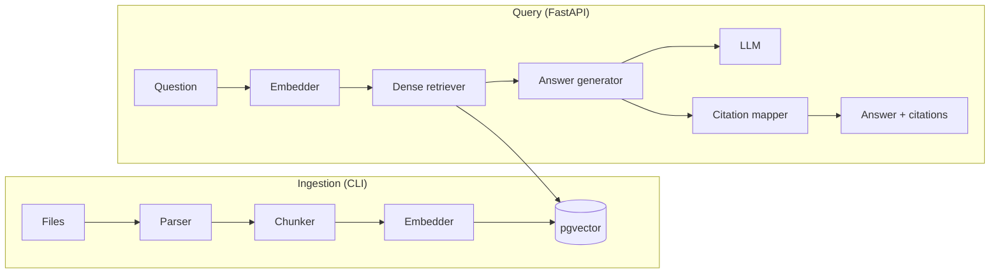

# Phase 1 plan: Baseline

_Status: draft · Last updated: 2026-10-17_

## Goal

Build the thinnest complete pipeline: parse contracts, chunk them, embed them, store them in pgvector, retrieve with dense search and return a grounded answer with citations, all started with `docker compose up`.

Phase 1 is about structure, not quality. Every later phase swaps or adds components behind the interfaces defined here and measures the difference, so the interfaces and data model matter more than any single implementation.

**Exit gate:** one cited answer end to end. A question about a sample contract returns an answer whose citation points to the correct document, page and character span, and an automated test proves it.

## Scope

### In scope

| Area | Phase 1 deliverable |
| --- | --- |
| Ingestion | PDF, DOCX, HTML and Markdown parsers that keep page numbers and headings; content-hash incremental indexing; updates and deletes reach every index; synchronous CLI |
| Chunking | Fixed-size and recursive chunkers; full metadata on every chunk |
| Embeddings | One open-source embedder (BGE-small-en-v1.5 via fastembed) |
| Storage | Postgres 16 + pgvector with an HNSW index |
| Retrieval | Dense top-k with metadata filters (document type, tenant) |
| Generation | One LLM interface; Anthropic adapter plus an OpenAI-compatible adapter (covers OpenAI, vLLM and Ollama) |
| Citations | Numbered context blocks, parsed `[n]` markers mapped to document, page and span; explicit refusal when evidence is missing |
| API | FastAPI `POST /query` (JSON and SSE streaming), `GET /healthz`; a `debug` flag that returns the retrieved chunks, their scores and the final prompt |
| Ops | `docker compose up` with a vendored sample of CUAD contracts, ingested on first start |
| Quality | ruff, mypy `--strict`, pytest with 80%+ coverage on core logic, GitHub Actions CI |
| Docs | ADR-001 (vector store), ADR-002 (embedder), ADR-003 (PDF parser); README stub with quickstart |

### Out of scope (later phase)

- Structure-aware and semantic chunking, parent/child chunks: Phase 3 chunking study
- BM25, hybrid search, reranking, query rewriting: Phase 3
- Citation verifier, metrics, golden set, LLM judge: Phase 2
- Async queue with retries and dead-letter queue: Phase 4 (the ingestion service is written so a queue worker can call it unchanged)
- Auth, rate limiting, access-control enforcement, PII redaction, the full prompt-injection suite, OpenTelemetry: Phase 4
- Table extraction from PDFs: revisit once the failure analysis shows it matters

The schema already has `tenant_id` and `access_tags` columns so Phase 4 needs no data migration, but nothing enforces them yet.

## Key decisions

Each of these gets a short ADR in `docs/adr/`. The full target architecture is in [`docs/architecture/`](../architecture/README.md).

1. **Postgres + pgvector as the only store.** One container provides vectors, metadata filters, transactions (so updates and deletes are atomic) and, in Phase 3, full-text search for BM25. Qdrant + OpenSearch stays the documented scaled option.
2. **fastembed with BGE-small-en-v1.5 (384 dimensions).** It runs on ONNX without PyTorch, which keeps the Docker image small and the first start fast. Stronger or API embedders get compared in Phase 3.
3. **pypdf for PDF parsing.** It is BSD licensed and gives text per page. PyMuPDF is faster and better at layout but is AGPL, which conflicts with this repo's Apache 2.0 license. Docling stays a candidate if structure extraction becomes the bottleneck.
4. **`typing.Protocol` interfaces plus frozen Pydantic models.** Implementations are chosen by config through a small registry, data objects are immutable, and tests use fakes instead of mocks.
5. **Plain SQL migrations with a tiny runner.** There is no ORM, so Alembic would add weight without benefit.
6. **The embedding model is recorded on each chunk.** If the configured model changes, the index refuses mixed vectors and asks for a reindex, which avoids silent quality drops.

## Architecture



### Repository layout

```text
src/open_rag_engine/
  domain/        # frozen Pydantic models: ParsedDocument, Document, Chunk, Span, Query, RequestContext, ScoredChunk, PipelineState, Answer, Citation
  interfaces/    # Protocols: Parser, Chunker, Embedder, DocumentRepository, VectorStore, Retriever, LLM, Stage; error hierarchy
  config/        # YAML loading + Pydantic settings, component registry
  ingestion/     # parsers/, chunkers/, service.py (IngestionService: hash, diff, upsert, delete)
  embeddings/    # fastembed adapter
  store/         # pgvector store, migrations/*.sql, migration runner
  retrieval/     # dense retriever
  generation/    # prompt builder, LLM adapters, citation mapper, refusal logic
  pipeline/      # QueryService, PipelineFactory, stage wrappers (tracing, timing)
  api/           # FastAPI app, routes, SSE
  cli.py         # `ore ingest`, `ore query`, `ore migrate`
tests/
  unit/  integration/  e2e/  fixtures/corpus/
configs/default.yaml
data/sample/     # vendored CUAD subset + NOTICE (CC BY 4.0 attribution)
docs/adr/  docs/plans/
docker/  docker-compose.yml  pyproject.toml
```

### Data model

```sql
documents (
  id uuid primary key, source_uri text unique not null, content_hash text not null,
  doc_type text not null, title text, tenant_id text not null default 'default',
  access_tags text[] not null default '{}', page_count int,
  created_at timestamptz, updated_at timestamptz
)

chunks (
  id uuid primary key, document_id uuid references documents on delete cascade,
  ordinal int not null, text text not null, section_path text[] not null default '{}',
  page_start int not null, page_end int not null, char_start int not null, char_end int not null,
  token_count int not null, embedding vector(384) not null, embedding_model text not null,
  chunker text not null, doc_type text not null, tenant_id text not null,
  access_tags text[] not null default '{}', created_at timestamptz
)
-- doc_type, tenant_id and access_tags are copied from documents so filtered ANN search needs no join
-- HNSW index on embedding (vector_cosine_ops); btree on (tenant_id, doc_type); GIN on access_tags
```

Character offsets refer to the document's full parsed text. The parser keeps a page-offset table, so any span maps back to page numbers, and the citation highlight is exact.

### Query response

```json
{
  "answer": "The agreement is governed by the laws of Delaware [1].",
  "refused": false,
  "citations": [
    {"marker": 1, "chunk_id": "…", "document_id": "…", "title": "…",
     "page_start": 12, "page_end": 12, "char_start": 40211, "char_end": 40388, "quote": "…"}
  ],
  "debug": {"retrieved": [{"chunk_id": "…", "score": 0.83}], "prompt": "…", "timings_ms": {"embed": 9, "retrieve": 14, "generate": 1180}}
}
```

Streaming sends `token` events while the answer is generated, then one final `citations` event, because citations can only be resolved once the full answer is known.

## Work breakdown

Sizes: S is half a day or less, M is one to two days, L is three days or more. Each task follows TDD: tests first, then implementation, then review.

| # | Task | Size | Depends on | Done when |
| --- | --- | --- | --- | --- |
| 1 | **Repo skeleton.** uv project, src layout, ruff, mypy strict, pytest + coverage, pre-commit, Makefile | S | — | `make check` runs lint, types and tests green on an empty package |
| 2 | **Domain models and interfaces.** Frozen models and Protocols listed above | S | 1 | Models validate (non-empty text, valid page and span ranges); Protocols type-check against fakes |
| 3 | **Config.** `configs/default.yaml`, Pydantic settings with environment overrides, component registry | S | 2 | Invalid config fails fast with a clear message; the resolved config can be dumped (needed for eval runs later) |
| 4 | **Parsers.** PDF (pypdf), DOCX (python-docx), HTML (selectolax), Markdown (markdown-it-py), all producing `Document` + pages + heading markers | M | 2 | Fixture files in each format parse with correct page count, headings and offsets; corrupt files raise a typed `ParseError` |
| 5 | **Chunkers.** Fixed-size (token window with overlap) and recursive (headings → paragraphs → sentences), token counts from the embedder's tokenizer | M | 2, 4 | Every chunk's span slices back to its exact text; no chunk exceeds the size limit; section path and pages are correct across page breaks |
| 6 | **Embedder.** fastembed adapter, batching, query vs. passage prefixes | S | 2 | Output dimension matches config; batches give the same vectors as single calls; the model name is exposed |
| 7 | **pgvector store and migrations.** Schema above, migration runner, upsert, delete by document, filtered top-k search | M | 2, 3 | Integration tests (Testcontainers) cover insert, search, filters, cascade delete and the embedding-model mismatch guard |
| 8 | **Ingestion pipeline and CLI.** Walk a source directory, hash, skip unchanged, reindex changed documents in one transaction, `--prune` deletes removed ones; `ore ingest` | M | 4–7 | Re-running ingest on an unchanged corpus does no work; editing a file replaces only its chunks; deleting a file removes its chunks; failures on one file are logged and the run continues with a summary |
| 9 | **Dense retriever.** Embed query, top-k with filters, minimum-score threshold | S | 6, 7 | Fixture corpus returns the expected chunk for known questions; filters exclude other tenants and document types |
| 10 | **LLM interface and adapters.** `generate` and `stream`, timeouts, typed errors; Anthropic and OpenAI-compatible adapters; a deterministic fake for tests | M | 2, 3 | Adapters pass a shared contract test (recorded responses); the provider is chosen by config with no code change |
| 11 | **Answer generation and citations.** Prompt with numbered context blocks wrapped in clear delimiters and marked as untrusted data; parse `[n]` markers; map them to chunks; drop markers that reference missing blocks; refuse when retrieval finds nothing above the threshold or the model says the evidence is missing | M | 9, 10 | Unit tests cover valid, invalid, duplicate and missing markers, refusal paths and an answer with no citations (flagged, not hidden) |
| 12 | **API.** FastAPI app, `POST /query` (JSON and SSE), `GET /healthz` (checks the database), `debug` flag, consistent error envelope, request validation | M | 11 | API tests cover both response modes, debug output, validation errors and a database-down health check |
| 13 | **Docker compose and sample data.** Postgres image with pgvector, API image with the embedding model baked in, one-shot seed service that runs migrations and ingests `data/sample/` (about 20 small CUAD contracts) | M | 8, 12 | From a clean clone, `docker compose up` answers a query in under five minutes on a laptop |
| 14 | **CI.** GitHub Actions: lint, mypy, unit and integration tests, coverage report, Docker build | S | 1, 7 | CI passes on main and fails on a lint, type or test error |
| 15 | **ADRs and README stub.** ADR-001 to ADR-003, quickstart in three commands, architecture diagram | S | 13 | A new reader can run the quickstart without asking questions |
| 16 | **Gate test.** End-to-end test against the composed stack with the fake LLM in CI and a manual run with a real provider | S | 13 | The test asks a known question (for example the governing law of a named sample contract) and asserts the citation's document, page and span are correct |

Suggested order: 1 → 2 → 3, then 4/6/7 in parallel, then 5 → 8 → 9, 10 in parallel with 8–9, then 11 → 12 → 13 → 16, with 14 set up right after 7 and 15 at the end.

## Parallel track: start the golden set now

Hand-writing questions is the slowest part of Phase 2. While Phase 1 is being built, write about 30 question/answer/evidence triples on the 20 sample contracts, with a few unanswerable and a few negation questions mixed in. They double as the manual smoke test for the gate and give Phase 2 a running start.

## Testing strategy

- **Unit:** parsers, chunkers, citation mapper, refusal logic and config, using fakes for Embedder, VectorStore and LLM.
- **Integration:** pgvector store and ingestion pipeline against a real Postgres in Testcontainers, using a five-document fixture corpus in `tests/fixtures/corpus/`.
- **Contract:** one shared test suite every LLM adapter must pass, run against recorded responses so CI needs no API keys.
- **End to end:** the gate test against the composed stack.
- **Coverage:** 80%+ on `domain`, `ingestion`, `retrieval` and `generation`; adapters are covered by contract tests.

## Risks

| Risk | Impact | Mitigation |
| --- | --- | --- |
| CUAD PDFs are scanned or have messy text layers | Bad chunks, wrong pages | Pick sample contracts with clean text layers; log per-document text yield; OCR stays out of scope |
| Page and span bookkeeping is off by a few characters | Citations highlight the wrong text, gate fails | Property test: for every chunk, `doc.text[char_start:char_end] == chunk.text`, and the page table agrees |
| Docker first start exceeds five minutes | Quickstart requirement fails | Bake the embedding model into the image; keep the sample small; measure in CI |
| The LLM ignores the citation format | Missing citations | Strict prompt with an example, lenient marker parsing, and answers without citations flagged in the response |
| Scope creep into Phase 3 features | Phase 1 drags on | Anything retrieval-quality related goes to the backlog until Phase 2 can measure it |

## Decisions to confirm

- **Default LLM for the demo:** an API provider (needs a key, better answers) or Ollama (free and offline, but a large download that threatens the five-minute start). Proposed: API provider by default, with Ollama as a documented compose profile.
- **Sample data:** vendor about 20 CUAD PDFs into the repo (offline, reproducible; CC BY 4.0 allows this with attribution) instead of downloading them on start. Proposed: vendor them.
